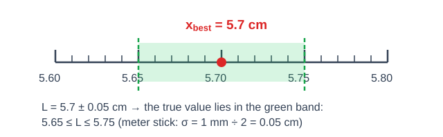
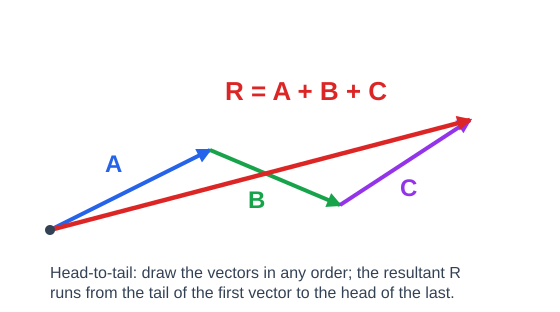
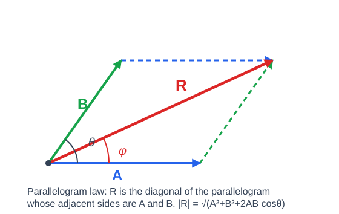
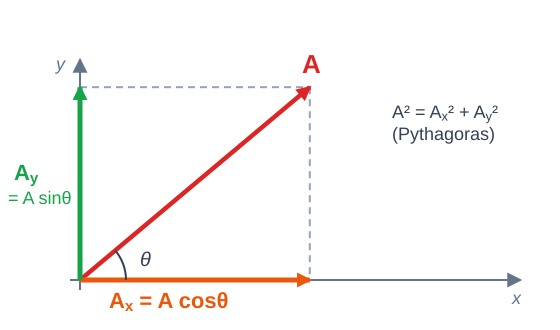
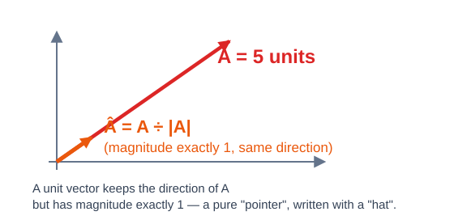

# Chapter 1 — Preliminaries · The Full Notes ⭐

> **Primary source (everything below follows it):** MoSHE *General Physics Module*
> (Phys 1011, October 2019) — Chapter One "Preliminaries", module pages 1–14.
> Full module PDF: [`RESOURCE/MoSHE_General_Physics_Module_Phys1011_2019_OFFICIAL.pdf`](../../RESOURCE/MoSHE_General_Physics_Module_Phys1011_2019_OFFICIAL.pdf)
>
> **Enriched with** the best open textbooks in our [`RESOURCE/`](../../RESOURCE) folder —
> every extra box, example and figure is labeled with its source. Worked solutions were
> computed and checked numerically. And the book the seniors keep recommending — **D.G.
> Simpson's *General Physics I: Classical Mechanics*** (Prince George's CC, 2019) — has now
> joined `RESOURCE/` and is woven through this note: SI history & trivia, the
> problem-solver's craft, density, vector tips and a dot-product preview.

## 📚 References used in this note (all free, all in RESOURCE)

| Source | Where | Use it for |
| --- | --- | --- |
| **MoSHE General Physics Module** (2019), Ch. 1 | [`RESOURCE/…Module…OFFICIAL.pdf`](../../RESOURCE/MoSHE_General_Physics_Module_Phys1011_2019_OFFICIAL.pdf) | The official course text — definitions, Tables 1.1–1.3, examples, review problems |
| **OpenStax, College Physics 2e**, Ch. 1 (§1.1–1.4) & Ch. 3 (§3.2–3.3) | [`RESOURCE/OpenStax_College_Physics_2e_Full.pdf`](../../RESOURCE/OpenStax_College_Physics_2e_Full.pdf) · [openstax.org/college-physics-2e](https://openstax.org/books/college-physics-2e) | Models vs theories vs laws, metric prefixes, order of magnitude, accuracy & precision, vector methods |
| **OpenStax, University Physics Vol. 1**, Ch. 1 (§1.1–1.7) & Ch. 2 (§2.1–2.3) | [`RESOURCE/OpenStax_University_Physics_Vol1_998p.pdf`](../../RESOURCE/OpenStax_University_Physics_Vol1_998p.pdf) · [openstax.org/university-physics-v1](https://openstax.org/books/university-physics-volume-1) | Rigorous SI standards history, dimensional analysis, Fermi estimates, vector algebra |
| **D.G. Simpson, *General Physics I: Classical Mechanics*** (PGCC, 2019) — the "recommended by seniors" book ⭐ | [`RESOURCE/Simpson_General_Physics_I_Classical_Mechanics_PGCC_2019.pdf`](../../RESOURCE/Simpson_General_Physics_I_Classical_Mechanics_PGCC_2019.pdf) | The sharpest short treatment of units & their history (§3), problem-solving strategy (Ch. 4), density (Ch. 5), vector arithmetic & the dot product (Ch. 7–8), Greek alphabet (App. B), trig identities (App. C), conversion tables (App. N) and Purcell's Round-Number Handbook (App. W) |
| **Worked Examples in Introductory Physics** (TTU, 172 pp.) | [`RESOURCE/Worked_Examples_Introductory_Physics_TTU_172p.pdf`](../../RESOURCE/Worked_Examples_Introductory_Physics_TTU_172p.pdf) | Extra solved problems to drill after this note |
| **Introductory Physics Problem Solving** (Lehman, 121 pp.) | [`RESOURCE/Introductory_Physics_Problem_Solving_Lehman_121p.pdf`](../../RESOURCE/Introductory_Physics_Problem_Solving_Lehman_121p.pdf) | Problem-solving strategy practice |
| **PhET: Vector Addition** (interactive) | [phet.colorado.edu → Vector Addition](https://phet.colorado.edu/en/simulations/vector-addition) | *Play* with head-to-tail and component addition until it clicks |

---

## 🗺️ Chapter map (module contents)

| Module section | Topic |
| --- | --- |
| 1.1 | Physical Quantities and Measurement — 1.1.1 Physical quantities · 1.1.2 SI Units: Basic and Derived Units · 1.1.3 Conversion of Units |
| 1.2 | Uncertainty in Measurement and Significant Digits — 1.2.1 Significant digits |
| 1.3 | Vectors: Composition and Resolution — 1.3.1 Vector Representation · 1.3.2 Vector Addition · 1.3.3 Components of Vector |
| 1.4 | Unit Vector — 1.4.1 Vector Addition in Unit Vector Notation · 1.4.2 Finding a Unit Vector |

**Contents:** [Intro](#introduction-module-page-1) · [1.1 Quantities & SI](#11-physical-quantities-and-measurement) · [1.2 Uncertainty & Sig-Figs](#12-uncertainty-in-measurement-and-significant-digits) · [1.3 Vectors](#13-vectors-composition-and-resolution) · [1.4 Unit Vectors](#14-unit-vector) · [Module Summary](#chapter-summary-module-page-13) · [Review Problems + Solutions](#chapter-review-questions-and-problems-module-page-14) · [Extra Practice](#extra-practice-set-answers-hidden--all-verified-numerically) · [Solver's Checklist](#problem-solvers-checklist-simpson-ch-4) · [Cheat Sheet](#one-page-cheat-sheet) · [Greek Letters](#greek-letters-you-will-meet-in-phys-1011) · [Brain Gym](#brain-gym-logic-puzzles-simpson-ch-2)

---

## Introduction (module, page 1)

- The word **physics** comes from the Greek word meaning **"nature"**. Physics is treated as the base for science, with various applications for the ease of life.
- Physics deals with **matter in relation to energy** and the **accurate measurement of natural phenomena** — so physics is inherently a **science of measurement**.
- The fundamentals of physics form the basis for the study and development of engineering and technology.
- **Measurement** consists of the comparison of an unknown quantity with a known fixed quantity. The quantity used as the standard of measurement is called a **unit**. (Module example: a vegetable vendor weighs vegetables in units like the kilogram.)

> 💡 **Why this chapter matters for your exam:** every later chapter (kinematics, fluids,
> electricity…) assumes you can (a) convert units fast, (b) keep significant figures
> correct, and (c) break vectors into components. Mid/final questions in this chapter are
> almost always *conversion + sig-figs + vector addition* — exactly what's drilled below.

### 🌌 The big picture: a map of physics (Simpson, Ch. 1)

Simpson opens his book with a one-page tour of the whole subject — handy for seeing where
Phys 1011 fits:

- **Classical mechanics** — *this course*: the motion of bodies according to Newton's laws.
- The other major fields: **electricity & magnetism**, **optics** (light), **acoustics**
  (sound), **thermodynamics & statistical mechanics** (heat), **quantum mechanics** (the very
  small), **solid-state / plasma / atomic / nuclear / particle physics**, and **relativity**
  (the very fast, plus Einstein's theory of gravity).
- Cross-disciplinary flavors: **astrophysics, geophysics, biophysics, chemical physics,
  mathematical physics**.
- Physics pays off twice: it builds a **broad technical background** *and* a **problem-solving
  skill** that transfers to engineering, biology, medicine — even finance. And Simpson's
  promise: *"everything you learn in this course will never be obsolete."*

### Learning objectives (module, page 1)

At the end of this chapter you will be able to:

1. Explain physics.
2. Describe how SI base units are defined.
3. Describe how derived units are created from base units.
4. Express quantities given in SI units using metric prefixes.
5. Describe the relationships among models, theories, and laws.
6. Know the units used to describe various physical quantities.
7. Become familiar with the prefixes used for larger and smaller quantities.
8. Master the use of unit conversion (dimensional analysis) in solving problems.
9. Understand the relationship between uncertainty and the number of significant figures in a number.

---

## 1.1 Physical Quantities and Measurement

> **Self-diagnostic test (module, page 1)** — try these before reading on:
> 1. Why do we need measurement in physics and in our day-to-day lives?
> 2. Give the names and abbreviations for the basic physical quantities and their corresponding SI units.
> 3. What do you mean by a unit?

### Key definitions (module, page 2)

- **Physical quantity** — a quantifiable or assignable property ascribed to a particular phenomenon or body; e.g. the length of a rod, the mass of a body.
- **Measurement** — the act of comparing a physical quantity with a certain standard (unit).

Scientists can even make up a completely new physical quantity if necessary. However, there is a **limited set of physical quantities of fundamental importance from which all other possible quantities can be derived**. Those are the **Basic (fundamental) Physical Quantities**; all the others are **Derived Physical Quantities**.

Giving numerical values to physical quantities and writing equations for physical principles lets us understand nature far more deeply than qualitative descriptions alone. The module highlights a profound simplicity of nature here: **all physical quantities can be expressed as combinations of only seven basic physical quantities.**

We define a physical quantity in one of two ways:

- by **specifying how it is measured** (e.g. distance with a meter stick, time with a stopwatch), or
- by **stating how it is calculated** from other measurements (e.g. average speed = total distance traveled ÷ time of travel).

Measurements of physical quantities are expressed in **units**, which are standardized values. Example (module): the length of a race can be expressed in meters (for sprinters) or kilometers (for distance runners). Without standardized units it would be extremely difficult for scientists to express and compare measured values in a meaningful way.

### 1.1.1 Physical quantities

**A. Basic (fundamental) physical quantities**

Quantities which **cannot be expressed in terms of any other physical quantity**.
Module examples: **length, mass, time**.

**B. Derived physical quantities**

Quantities that **can be expressed in terms of fundamental quantities**.
Module examples: **area, volume, density**.

> 🧠 **Memory hook:** if you can *build it* from length, mass, time (+ the other base
> quantities), it's **derived**. If it's an independent *ingredient*, it's **basic**.

### 1.1.2 SI Units: Basic and Derived Units

**SI** is the abbreviation for the **International System of Units** — the modern form of the metric system, finally agreed upon at the **eleventh International Conference of Weights and Measures, 1960**. It is adopted throughout the world, remains the primary system of measurement, and is logically superior to any other system. It is **built upon 7 basic quantities** and their associated units.

**Table 1.1 — Basic quantities and their SI units** (module, page 3)

| Property | Symbol | Unit | Dimension |
| --- | :---: | :---: | :---: |
| **Length** | $L$ | meter (m) | $L$ |
| **Mass** | $m$ | kilogram (kg) | $M$ |
| **Time** | $t$ | second (s) | $T$ |
| **Temperature** | $T$ | kelvin (K) | $\theta$ |
| **Electric Current** | $I$ | ampere (A) | $I$ |
| Amount of Substance | $N$ | mole (N) | $1$ |
| Luminous Intensity | $F$ | candela (cd) | $J$ |

**Table 1.2 — Derived quantities, their SI units and dimensions** (module, page 3)

| Property | Symbol | Unit | Dimension |
| --- | :---: | :---: | :---: |
| Force | $F$ | newton (N) | $\mathrm{kg\cdot m\cdot s^{-2} = kg\cdot m/s^2}$ |
| Speed | $v$ | meter per second (m/s) | $\mathrm{m\cdot s^{-1} = m/s}$ |
| Pressure | $P$ | pascal (Pa) | (force per unit area) $\mathrm{kg\cdot m^{-1}\cdot s^{-2}}$ |
| Energy | $E$ | joule (J) | $\mathrm{kg\cdot m^{2}\cdot s^{-2}}$ |
| Power | $W$ | watt (W) | (energy per unit time) $\mathrm{kg\cdot m^{2}\cdot s^{-3}}$ |

> **Study tip:** notice how each derived unit is built purely from the base units of Table 1.1 — that is exactly what the "dimension" column records (e.g. a newton is $\mathrm{kg\cdot m/s^2}$).

> 🌍 **Did you know? (OpenStax University Physics, §1.2)** — since **20 May 2019** every SI
> unit is pinned to fixed constants of nature, not to objects:
> the **second** = 9 192 631 770 periods of the cesium-133 atom's radiation; the **meter**
> = the distance light travels in 1/299 792 458 s; the **kilogram** is defined by fixing the
> Planck constant $h = 6.62607015\times10^{-34}\ \mathrm{J\cdot s}$ (the old platinum-iridium
> cylinder in Paris is retired!); the **ampere** by fixing $e = 1.602176634\times10^{-19}$ C;
> the **kelvin** by fixing Boltzmann's $k_B = 1.380649\times10^{-23}\ \mathrm{J/K}$; the
> **mole** by fixing $N_A = 6.02214076\times10^{23}\ \mathrm{mol^{-1}}$.

> 🥇 **Derived quantity in action — density (Simpson, Ch. 5).** The module names *density* as
> a derived quantity; Simpson shows why it earns the title. **Density = mass per unit volume:**
> $$\rho = \frac{M}{V}, \qquad \text{SI unit: } \mathrm{kg/m^3}$$
> The anchor to memorize is water: $1\ \mathrm{g/cm^3} = 1000\ \mathrm{kg/m^3}$ — and deriving
> that factor is itself a conversion drill:
> $1\ \mathrm{g/cm^3} = \dfrac{10^{-3}\ \mathrm{kg}}{(10^{-2}\ \mathrm{m})^3} = 10^{3}\ \mathrm{kg/m^3}$.
> **Specific gravity** = density relative to water — a pure number (gold: 19.3, *no units*).
> **The gold-brick test** (Archimedes' classic trick): measure mass and volume, divide — solid
> gold gives 19.3 g/cm³, gold-*painted* lead only 11.35 g/cm³. Impostor caught by arithmetic
> alone.
> 🪐 Fun: Saturn's average density is 0.687 g/cm³ — the only planet light enough to **float**
> in water. And ice floats because water is densest at 4 °C and *expands* on freezing — which
> is why lakes freeze top-down and fish survive the winter.

### Metric prefixes — module objectives 4 & 7 (supplement from OpenStax College Physics 2e, §1.2, Table 1.2)

The module's learning objectives ask you to "express quantities using metric prefixes" and
"become familiar with prefixes for larger and smaller quantities". Learn this table — it is
the fastest way to handle very large or very small numbers:

| Prefix | Symbol | Value | Prefix | Symbol | Value |
| --- | :---: | :---: | --- | :---: | :---: |
| tera | T | $10^{12}$ | deci | d | $10^{-1}$ |
| giga | G | $10^{9}$ | centi | c | $10^{-2}$ |
| mega | M | $10^{6}$ | milli | m | $10^{-3}$ |
| kilo | k | $10^{3}$ | micro | µ | $10^{-6}$ |
| hecto | h | $10^{2}$ | nano | n | $10^{-9}$ |
| deka | da | $10^{1}$ | pico | p | $10^{-12}$ |

- **Order of magnitude** (OpenStax CP2e §1.2): the scale of a value expressed as a power of ten — a "ballpark" class of size. 800 and 900 are the same order of magnitude ($\sim10^{3}$); 800 and 8 000 are not. Physicists use orders of magnitude to compare huge ranges, e.g. an atom ($\sim10^{-10}$ m) vs. its nucleus ($\sim10^{-15}$ m) — five orders of magnitude smaller.
- Example: $5.08\times10^{-4}$ m (module example below) = **0.508 mm** = **508 µm** — one length, three prefix choices.

### Other systems of units you will meet (Simpson, §3.1, §3.3–3.4)

SI is not the only system in town — the module's Table 1.3 already makes you convert British
units, and Simpson adds the vocabulary:

| System | Base units | Force / energy | Notes |
| --- | --- | --- | --- |
| **SI (an MKS system)** | m, kg, s (+ A, K, cd, mol) | newton / joule | the course standard |
| **CGS** (several variants; **Gaussian** most common) | cm, g, s | dyne $= \mathrm{g\cdot cm/s^2}$ / erg $= \mathrm{g\cdot cm^2/s^2}$ | still customary in astrophysics & plasma physics; $1\ \mathrm{N} = 10^{5}\ \mathrm{dyne}$, $1\ \mathrm{J} = 10^{7}\ \mathrm{erg}$ |
| **British engineering** | foot, **slug**, second | pound-force (lbf) | $1\ \mathrm{slug} = 14.59\ \mathrm{kg}$ (it weighs $32.174\ \mathrm{lbf}$); SI prefixes are *not* used; the everyday "pound" is really pound-mass, $1\ \mathrm{lbm} = 0.45359237\ \mathrm{kg}$ exactly |

> 📐 **The radian — the SI (derived) unit of angle (Simpson, §3.2 & App. O).** One radian is
> the angle whose arc length equals the radius; a full circle is $2\pi$ rad $= 360^\circ$:
> $$\text{degrees} = \text{radians}\times\frac{180^\circ}{\pi}, \qquad \text{radians} = \text{degrees}\times\frac{\pi}{180^\circ}$$
> Whenever an angle appears "bare" in a formula — e.g. arc length $s = r\theta$ — the angle
> **must be in radians**. File this away for circular motion later in the course.

### Models, Theories, and Laws — module objective 5 (supplement from OpenStax College Physics 2e, §1.1)

The module lists "describe the relationships among models, theories, and laws" as a learning
objective; the clearest short treatment is OpenStax §1.1:

- **Law** — uses **concise language, often a single equation**, to describe a *generalized pattern in nature* supported by scientific evidence and repeated experiments (e.g. Newton's law of gravitation). Laws are intrinsic to the universe: humans did not create them and cannot change them — we only **discover** them.
- **Theory** — an **explanation for patterns in nature** that is supported by scientific evidence and **verified multiple times by various groups of researchers** (e.g. the kinetic theory of gases). Some theories include models; others don't.
- **Model** — a **representation of something often too difficult (or impossible) to display directly**, accurate only in limited situations (e.g. the planetary model of the atom). Models help analyze scenarios and run simulations.

> They are **not ranked** "law > theory": a law *describes* **what** happens, a theory
> explains **why**, a model helps us *picture* it. All three must survive experiments — if a
> verifiable experiment contradicts them, they must be modified or overthrown.

### 1.1.3 Conversion of Units

To convert a quantity from one unit to another, **multiply by conversion factors in such a way that you cancel the units you want to get rid of and introduce the units you want to end up with.**

**Table 1.3 — Unit conversion of basic quantities** (module, page 4)

| Quantity | From | To | Operation |
| --- | :---: | :---: | :---: |
| Length | inch (in) | m | (inch) × 0.0254 |
| | foot (ft) | m | (foot) × 0.3048 |
| | mile (mi) | m | (mile) × 1609.34 |
| Mass | pound (lb) | kg | (pound) × 0.4536 |
| | metric ton (t) | kg | (ton) × 1000 |
| | ounce | kg | (ounce) × 0.02835 |
| Volume | liter (l) | m³ | (liter) × 0.001 |
| | gallon (ga) | m³ | (gallon) × 0.00379 |
| Temperature | fahrenheit (F) | K | {(fahrenheit) − 32} × 5/9 + 273.15 |
| | celsius (C) | K | (celsius) + 273.15 |

**Worked examples (module, page 4):**

1. Convert a length of **0.02 in** into SI meters:

   $$0.02\ \text{in} = 0.02 \times 0.0254\ \text{m} = 0.000508\ \text{m} = 5.08\times10^{-4}\ \text{m} = 0.508\ \text{mm or } 508\ \mu\text{m}$$

   *(The module's print reads "0.503 mm", but 0.000508 m = 0.508 mm — the "0.503" is a typographical slip; the 508 µm in the same line confirms 0.508 mm.)*

2. A **Honda Fit** weighs about **2,500 lb**. Equivalent mass:

   $$2500 \times 0.4536\ \text{kg} = 1134.0\ \text{kg}$$

> 🔧 **The factor-label method (dimensional analysis), applied.** Treat units like algebra
> that cancels. The module's Activity 1 solved step by step:
> $$30\ \frac{\text{km}}{\text{hr}} \times \frac{1000\ \text{m}}{1\ \text{km}} \times \frac{1\ \text{mi}}{1609.34\ \text{m}} = 18.64\ \frac{\text{mi}}{\text{hr}}$$
> km cancels, m cancels, only mi/hr survives. This "chain of fractions" is *the* technique
> objective 8 means by "unit conversion (dimensional analysis)".

> 🎓 **Two master-class chains (Simpson, §3.6).** Same technique, longer chain — once you can
> do these, no conversion will scare you:
> $$60\ \frac{\text{mi}}{\text{hr}} \times \frac{5280\ \text{ft}}{1\ \text{mi}} \times \frac{1\ \text{hr}}{3600\ \text{s}} = 88\ \frac{\text{ft}}{\text{s}} \qquad \text{(highway speed in ft/s)}$$
> and the legendary:
> $$250\,000\ \frac{\text{furlongs}}{\text{fortnight}} = 41.58\ \frac{\text{m}}{\text{s}}$$
> via furlong → mile → km → m and fortnight → week → day → hr → min → s. Eight factors, zero
> panic: cancel, cancel, cancel. Even money obeys the rules — an exchange rate is just a
> conversion factor that changes daily: at a rate of (say) $1\ \text{USD} = 130\ \text{ETB}$, a
> 650 ETB lab manual costs $650/130 = 5.00$ USD. Method first, numbers second.

> ✅ **Simpson's 6 unit-checking principles (§3.5) — dimensional analysis as an error detector.**
> Wrong units prove a derivation *definitely* wrong; matching units make it *probably* sane.
>
> 1. Units on **both sides** of an equation must match.
> 2. Only quantities with the **same units** may be added or subtracted.
> 3. Quantities appearing as **exponents must be dimensionless**.
> 4. Arguments of $\sin$, $\cos$, $\tan$, $\log$, $\exp$ must be **dimensionless**.
> 5. Radians and steradians count as **dimensionless** when checking.
> 6. For messy derived units, **break everything down to base units** (N → kg·m/s², J → kg·m²/s², …) before comparing.

**Activities (module, page 4)** — try, then open the worked answers:

1. A common Ethiopian cities speed limit is 30 km/hr. What is this speed in miles per hour?
2. How many cubic meters are in 250,000 cubic centimeters?
3. The average body temperature of a house cat is 101.5 °F. What is this temperature in Celsius?

✅ Worked answers to the module activities (computed & checked)

1. **30 km/hr = 18.64 mi/hr** — chain: $30 \times 1000/1609.34$ (using Table 1.3: 1 mile = 1609.34 m).
2. **250 000 cm³ = 0.25 m³.** ⚠️ Cube the length factor: $1\ \text{m} = 100\ \text{cm}$ ⇒ $(100)^3 = 10^{6}\ \text{cm}^3$ per m³ ⇒ $250\,000 / 10^{6} = 0.25$. (For areas: $1\ \text{m}^2 = 10^{4}\ \text{cm}^2$.)
3. **101.5 °F = 38.61 °C** — Table 1.3 rule: $(101.5-32)\times\tfrac{5}{9} = 69.5\times\tfrac{5}{9} = 38.61$. (An actual healthy cat runs ≈ 38–39 °C — physics checks out. 🐈)

> ⚠️ **Common pitfalls (exam-killers):**
> - Forgetting to **square/cube** conversion factors for areas/volumes (pitfall #2 above).
> - Mixing **temperature *scales*** (°C, °F — affine, need offset) with **temperature
>   *differences*** (Δ1 °C = Δ1 K exactly).
> - Writing 1 kg = 2.2 lb "in SI" — the pound is a unit of *weight (force)* in everyday US
>   usage; Table 1.3's ×0.4536 converts the mass unit **pound-mass**.

> 🤓 **SI trivia corner (Simpson, §3.8)** — fun facts that double as safe habits:
> - It's **megohm** and **kilohm**, not "megaohm"/"kiloohm" — the prefix drops its vowel
>   before ohm.
> - Medicine bottles write **mcg** for microgram so nobody misreads µg as mg. Cute, but don't
>   imitate it in physics — write µg.
> - Electronics often uses the prefix symbol as the decimal point: $24\ \mathrm{M\Omega}$ becomes
>   **"24M9"**. Saves space on circuit diagrams; unofficial everywhere else.
> - The **micron** and **millimicron** are obsolete — say **micrometer** ($10^{-6}$ m) and
>   **nanometer** ($10^{-9}$ m). The prefix **myria-** ($10^{4}$) is dead as well.
> - In computing, "1 kB" can mean 1000 *or* 1024 bytes; binary prefixes (KiB, MiB, …) were
>   invented to end that argument. Physics keeps $1\ \mathrm{k} = 10^{3}$ exactly.

---

## 1.2 Uncertainty in Measurement and Significant Digits

### Why every measurement has uncertainty (module, pages 4–5)

- Measurements are **always uncertain**. It was hoped that better and better experiments could improve uncertainty without limit — it turned out not to be the case. **No measurement of a physical quantity can be entirely accurate.**
- It is therefore important to know **how much the measured value is likely to deviate from the unknown, true value**. The art of estimating these deviations should probably be called *uncertainty analysis*, but for historical reasons it is referred to as **error analysis**.
- **Uncertainty** gives the **range of possible values** of the measurement, which covers the true value. It characterizes the **spread** of measurement results; the interval is commonly accompanied by a **confidence level**. The uncertainty also indicates a **doubt about how well the result represents** the quantity being measured.
- All measurements always have some uncertainty — we refer to this uncertainty as the **error** of the measurement.

**Preferred form of any measurement (module, page 6):**

$$\text{Measurement} = x_{best} \pm \sigma_x$$

where $x_{best}$ = best estimate of the measurement, and $\sigma_x$ = uncertainty (error) in the measurement.

> 🎯 **Accuracy vs Precision** (OpenStax College Physics 2e, §1.3 — know the difference!):
> - **Accuracy** = how close a measurement is to the **true/correct value**.
> - **Precision** = how close **repeated measurements** are to **each other** (small spread).
> - OpenStax's paper example: a sheet labeled 11.0 in measured as 11.1, 11.2, 10.9 in →
>   *accurate* (near 11.0) and *precise* (spread only 0.3 in). Measurements 10.9, 11.1,
>   11.9 in would be accurate-ish but **imprecise**. An out-of-calibration instrument can be
>   very precise yet systematically inaccurate — which is exactly the module's next point.
> - **Uncertainty** is the quantitative measure of that spread (module: "a disclaimer for
>   your measured values" — e.g. 45 000 ± 500 miles on a car's odometer).

### The two categories of errors (module, page 5)

1. **Systematic Error** — errors resulting from **measuring devices being out of calibration**. Such measurements are **consistently too small or too large**. They can be **eliminated by pre-calibrating** against a known, trusted standard.
2. **Random Errors** — errors resulting in the **fluctuation of measurements of the same quantity about the average**; the measurements are equally probable of being too large or too small. They generally result from the **fineness of scale division** of a measuring device.

Systematic errors are generally "simple" to analyze; random errors require more careful (statistical) analysis, which is the module's focus here.

> 🧠 **Memory hook:** *Systematic = Same shift every time* (calibration → fix by recalibrating).
> *Random = Racous scatter* (statistics → reduce by averaging / finer reading).

### Rules of thumb for the uncertainty of a single measurement (module, pages 5–6)

1. **Scale (analogue) measuring device:** the uncertainty equals the **smallest increment divided by 2**:

   $$\sigma_x = \frac{\text{smallest increment}}{2}$$

   *Example — meter stick (scale device):* smallest increment = 1 mm, so

   $$\sigma_x = \frac{1\ \text{mm}}{2} = 0.5\ \text{mm} = 0.05\ \text{cm}$$

2. **Digital measuring device:** the uncertainty equals the **smallest increment** itself:

   $$\sigma_x = \text{smallest increment}$$

   *Example — digital balance:* a reading of **5.7513 kg** implies $\sigma_x = 0.0001\ \text{kg}$ (the smallest increment is in the last decimal place, 0.0001 kg).

**Implied uncertainty.** Even when uncertainty is not stated explicitly, it is still implied. If we measure a length of **5.7 cm** with a meter stick, the true length can be anywhere in the range $5.65\ \text{cm} \le L \le 5.75\ \text{cm}$ — an implied uncertainty of **0.05 cm**. A common rule of thumb: take **one-half of the unit of the last decimal place** in the measurement.

### 1.2.1 Significant digits

- The number of **meaningful digits** you write down implies the error of the measurement.
- Module example: if a length is **0.428 m**, you imply an uncertainty of about **0.001 m**. Writing it as 0.4 would imply you only know it to 0.1 m; writing 0.42819667 would imply knowledge to 0.00000001 m. **Report only as many significant figures as are consistent with the estimated error.**
- $0.428$ m has **three significant digits** — three digits that make sense in terms of the measurement. This has **nothing to do with the number of decimal places**: the same measurement in centimeters is 42.8 cm and is still three significant figures.
- **Accepted convention:** only **one uncertain digit** is reported for a measurement. If the estimated error is 0.02 m, report $0.43 \pm 0.02$ m — **not** $0.428 \pm 0.02$ m.

**When is a zero significant?** (module, pages 6–7)

> **The rule:** if the zero has a non-zero digit anywhere to its **left**, then the zero is significant; otherwise it is not.

- $5.00$ → 3 significant figures
- $0.0005$ → only 1 significant figure
- $1.0005$ → 5 significant figures
- A number like $300$ is **not well defined** — write instead $3\times10^{2}$ (one significant figure) or $3.00\times10^{2}$ (three significant figures).
- Zeros used **only to locate the decimal point** are NOT significant:
  1. $0.0062$ cm has **2** significant figures
  2. $4.0500$ cm has **5** significant figures

**Rules for significant digits in calculations (module, page 7):**

- **Rule 1 — Multiplication / Division:** the number of significant digits in the final answer is the same as the number of significant digits in the **least accurate factor**.

  *Example (module):*

  $$X = \frac{45}{(3.22\ \text{m})(2.005\ \text{m})} = 6.97015\ \frac{\text{N}}{\text{m}^2}$$

  The least significant factor (**45**) has only **two** digits, so only two are justified in the answer. The appropriate way to write the answer is $X = 7.0\ \text{N/m}^2$.

- **Rule 2 — Addition / Subtraction:** the answer should have the same number of **decimal places** as the term with the **smallest number of decimal places**.

  *Example (module):* $9.65\ \text{cm} + 8.4\ \text{cm} - 2.89\ \text{cm} = 15.16\ \text{cm}$.
  The **least precise** measure is **8.4 cm**, so the answer must be to the nearest **tenth** of a cm (even though that requires 3 significant digits): the appropriate way to write the answer is **15.2 cm**.

- *Area example (module):* find the area of a metal plate that is 8.71 cm by 3.2 cm:

  $$A = LW = (8.71\ \text{cm})(3.2\ \text{cm}) = 27.872\ \text{cm}^2$$

  Applying Rule 1 (3.2 cm has only 2 significant digits), the result should be reported as **28 cm²**.

> ➕ **Two more drills (same rules, new numbers):**
> - $(3.456\ \text{m})(2.1\ \text{m}) = 7.2576\ \text{m}^2 \Rightarrow$ Rule 1 (2.1 has 2 sig-figs) → **7.3 m²**
> - $15.75 + 3.2 + 8.104 = 27.054 \Rightarrow$ Rule 2 (3.2 has 1 decimal place) → **27.1**

**In general, to determine significant digits in a given number (module, page 7):**

1. All non-zero numbers are significant.
2. Zeros **within** a number are always significant.
3. Zeros that do nothing but **set the decimal point** are not significant — both 0.000098 and 0.98 contain two significant figures.
4. Zeros that **aren't needed to hold the decimal point** are significant — e.g. 4.00 has three significant figures.
5. Zeros that **follow** a number *may* be significant.

> ⚠️ **Exam trap:** Rule 1 counts **significant digits**; Rule 2 counts **decimal places**.
> Mixing them up ("15.16 → two sig-figs → 15 cm") loses easy marks. Multiply → sig-figs;
> add → decimal places. That's the whole game.

---

## 1.3 Vectors: Composition and Resolution

### Scalar vs vector (module, page 8)

| | **Scalar** | **Vector** |
| --- | --- | --- |
| Specified by | a number and a unit (magnitude only) | both a **magnitude** and a **direction** in space |
| Obeys | the rules of ordinary algebra | the laws of vector algebra |
| Examples | mass, time, volume, speed, … | displacement, velocity, acceleration, momentum, … |

🎯 Quick self-quiz: scalar or vector? (click to reveal)

| Quantity | Answer | Why |
| --- | --- | --- |
| distance | scalar | just a number of meters |
| displacement | vector | "3 km *east*" has direction |
| speed | scalar | no direction (60 km/hr) |
| velocity | vector | 60 km/hr *north* |
| mass | scalar | 5 kg has no direction |
| weight | vector | it's a **force** — points down (contrasts with mass!) |
| temperature | scalar | no direction |
| acceleration | vector | magnitude + direction |
| energy / work | scalar | despite being "big" physics quantities |
| force | vector | pushes/pulls in a direction |

### 1.3.1 Vector Representation

**A. Algebraic method**

- Vectors are represented by a letter (or symbol) with an **arrow over its head** — e.g. velocity $\vec v$, momentum $\vec p$.
- The **magnitude** of a vector is a **positive scalar**, written as $|\vec A|$ or simply $A$.

**B. Geometric method**

It is often useful to draw a picture (a line with an arrow):

- Vectors are straight **arrows drawn from one point to another**.
- The **zero vector** is just a vector of zero length — a point.
- The **length** of the arrow is the **magnitude** of the vector — the longer the arrow, the bigger the magnitude.
- Vectors can be **parallel-transported** around: if you attach the beginning (tail) of vector $\vec B$ to the end (head) of vector $\vec A$, then $\vec A + \vec B$ is the straight arrow from the beginning of $\vec A$ to the end of $\vec B$.

**Properties to remember (module, page 8):**

- A vector changes if its **magnitude**, its **direction**, or **both** change.
- We add, subtract or equate only physical quantities of the **same units and same character** — all terms on both sides of an equation must be either **all scalar** or **all vector**.
- A vector may be multiplied by a **pure number**: this merely changes the magnitude; if the number is **negative**, the direction is **reversed**.
- When a vector is multiplied by a **scalar**, the new vector generally becomes a **different physical quantity** — e.g. velocity (vector) × time (scalar) = **displacement**.

> 🖍️ **Notation corner (Simpson, §7.1) — vectors perpendicular to the page.** In 3-D diagrams
> you will soon need arrows pointing into or out of the page (magnetic fields, torques):
> - ⊙ — circle with a dot: the **arrowhead flying at you**, i.e. a vector **out of** the page.
> - ⊗ — circle with a cross: the **tail feathers flying away from you**, i.e. a vector
>   **into** the page.
>
> Dot = tip coming at you. Draw it once and you will never mix them up.

### 1.3.2 Vector Addition

A single vector obtained by adding two or more vectors is called the **resultant vector**. The module gives two methods:

**A. Graphical (head-to-tail) method**

- Join the vectors **head to tail, in any order**.
- The resultant is the vector drawn from the **tail of the first vector** to the **head of the last vector**.
- For three vectors the resultant $\vec R = \vec A + \vec B + \vec C$ is the vector that **completes the polygon** (module Figure 1).

> ✏️ **Worked example 1 (graphical idea, done with components).** Walk **3 km east**, then
> **4 km north**. Head-to-tail sketch ⇒ R closes the triangle:
> $$R = \sqrt{3^2 + 4^2} = 5\ \text{km}, \qquad \phi = \tan^{-1}\!\left(\tfrac{4}{3}\right) = 53.1^{\circ}\ \text{north of east}$$
> Classic 3-4-5 triangle — and proof that **magnitudes don't simply add** (3 + 4 ≠ 5!).
> Try the same sum visually in the [PhET Vector Addition sim](https://phet.colorado.edu/en/simulations/vector-addition).

**B. Parallelogram law of vector addition**

- The resultant $\vec R$ of two vectors $\vec A$ and $\vec B$ is the **diagonal of the parallelogram** for which $\vec A$ and $\vec B$ are adjacent sides. All three vectors $\vec A$, $\vec B$, $\vec R$ are **concurrent** (module Figure 2). $\vec A$ and $\vec B$ are also called the **components** of $\vec R$.
- The **magnitude** of the diagonal is obtained with the **cosine law**, and the **direction** (the angle the diagonal makes with the sides) with the **sine law**. Applying them to the triangle formed by the two vectors:

  **Cosine law (magnitude of the resultant):**

  $$R = \sqrt{A^2 + B^2 + 2AB\cos\theta}$$

  where $\theta$ is the angle between $\vec A$ and $\vec B$.

  **Sine law (direction of the resultant):** with $\phi$ the angle between $\vec R$ and $\vec A$, and $\psi$ the angle between $\vec R$ and $\vec B$,

  $$\frac{\sin\phi}{B} = \frac{\sin\psi}{A} = \frac{\sin(180^\circ - \theta)}{R} = \frac{\sin\theta}{R}$$

> ✏️ **Worked example 2 (parallelogram law).** $\vec A$ = 6 units, $\vec B$ = 4 units,
> $\theta = 60^{\circ}$ between them.
> - Cosine law: $R = \sqrt{6^2 + 4^2 + 2(6)(4)\cos 60^{\circ}} = \sqrt{36+16+24} = \sqrt{76} = 8.72$ units
> - Sine law: $\sin\phi = \dfrac{B\sin(180^{\circ}-60^{\circ})}{R} = \dfrac{4\sin 120^{\circ}}{8.72} = 0.397 \Rightarrow \phi = 23.4^{\circ}$ from $\vec A$
> - ✔ Check with components: $\vec R = (6+4\cos60^{\circ},\ 4\sin60^{\circ}) = (8,\ 3.46)$ → $|\vec R| = 8.72$, angle $= \tan^{-1}(3.46/8) = 23.4^{\circ}$. Both methods agree.
>
> **Special cases worth memorizing:** θ = 0° ⇒ R = A + B (parallel, same direction); θ = 180° ⇒ R = |A − B| (anti-parallel); θ = 90° ⇒ R = √(A²+B²) (Pythagoras).

> ✂️ **Subtraction & polar form (Simpson, §7.2–7.3) — three tips that save marks:**
> - **Graphical subtraction:** place the two vectors **tail to tail**; then $\vec A - \vec B$
>   runs **from the head of $\vec B$ to the head of $\vec A$** (from the vector being
>   subtracted, towards the one you keep).
> - **Polar form:** a plane vector can be written $\vec A = A\angle\theta$ — magnitude plus
>   angle measured counterclockwise from the $+x$ axis. Compact for *storing*, useless for
>   *adding*: convert to components first, add component-wise, convert back if asked.
> - **Calculator trap:** $\tan^{-1}(A_y/A_x)$ only ever returns an angle between $-90^\circ$ and
>   $+90^\circ$. If $A_x < 0$, **add 180°** to the calculator's answer — that is how the
>   $112.5^\circ$ in review problem 1(a) is found.

### 1.3.3 Components of Vector

Resolving a vector means replacing it by two (or three) perpendicular vectors that add up to the original. Considering module Figure 3, the components of $\vec A$ are obtained with the trigonometric functions **sine** and **cosine**:

- $A_x = A\cos\theta$ — the $x$ component of $\vec A$
- $A_y = A\sin\theta$ — the $y$ component of $\vec A$

The components $A_x$ and $A_y$ can be **added to give back $\vec A$** as their resultant: $\vec A = \vec A_x + \vec A_y$. Because they are **perpendicular**, the magnitude of the resultant is obtained with **Pythagoras' theorem**:

$$A = \sqrt{A_x^2 + A_y^2}$$

**Three dimensions.** Any 3-D vector $\vec A$ can be written as the sum of its $x$, $y$ and $z$ components:

$$\vec A = \vec A_x + \vec A_y + \vec A_z, \qquad A = \sqrt{A_x^2 + A_y^2 + A_z^2}$$

The direction angles the vector makes with the three axes are given by the **direction cosines** (module Figure 4):

$$\cos\alpha = \frac{A_x}{A}, \qquad \cos\beta = \frac{A_y}{A}, \qquad \cos\gamma = \frac{A_z}{A}$$

> ✏️ **Worked example 3 (resolution).** $\vec A$ = 10 units at $\theta = 35^{\circ}$ from the +x axis:
> $$A_x = 10\cos 35^{\circ} = 8.19, \qquad A_y = 10\sin 35^{\circ} = 5.74$$
> And a 3-D one: $\vec A = 2\hat i + 3\hat j + 6\hat k$ ⇒ $A = \sqrt{4+9+36} = 7$, with direction cosines $\cos\alpha = 2/7$, $\cos\beta = 3/7$, $\cos\gamma = 6/7$.

> ⚠️ **Common pitfalls:**
> - Adding magnitudes directly only works when vectors are **parallel** — otherwise you must
>   use the cosine law or components ("3 km east + 4 km north ≠ 7 km").
> - Always define angles **from the +x axis** (counter-clockwise positive) before resolving;
>   then $A_x = A\cos\theta$, $A_y = A\sin\theta$ work automatically — including for angles
>   in the 2nd/3rd quadrants (the minus signs come out of the cosine/sine by themselves).

---

## 1.4 Unit Vector

- A **unit vector** is a vector of **magnitude one**. It is **dimensionless**, and its sole purpose is to **point** — to specify a given direction. It is usually denoted with a **"hat"**: $\hat n$.
- The special Cartesian coordinate unit vectors (module, page 11): for a 2-D $x$–$y$ system, $\hat i$ points in the $+x$ direction and $\hat j$ in the $+y$ direction; for a 3-D system we add $\hat k$ pointing in the $+z$ direction.

**Any vector can be expressed in terms of unit vectors.** For $\vec A$ with components $A_x, A_y, A_z$:

- The product $A_x\hat i$ has magnitude $|A_x|$ in the $+x$ direction — it **is** the $x$-component of $\vec A$; similarly $A_y\hat j$ and $A_z\hat k$.
- Therefore:

  $$\vec A = A_x\hat i + A_y\hat j + A_z\hat k$$

  The module (Figure 4) depicts $\vec A$ along with $A_x\hat i$, $A_y\hat j$ and $A_z\hat k$ drawn so it is clear that the three of them add up to $\vec A$.

### 1.4.1 Vector addition in unit-vector notation

Adding vectors in unit-vector notation is easy because the **individual unit vectors can be factored out**. For (module, pages 11–12)

$$\vec A = A_x\hat i + A_y\hat j + A_z\hat k \qquad\text{and}\qquad \vec B = B_x\hat i + B_y\hat j + B_z\hat k$$

$$\vec A + \vec B = (A_x + B_x)\hat i + (A_y + B_y)\hat j + (A_z + B_z)\hat k$$

The sum of vectors in unit-vector notation is simply **the sum of the $x$ components times $\hat i$, plus the sum of the $y$ components times $\hat j$, plus the sum of the $z$ components times $\hat k$** (subtraction works the same way, component by component).

### 1.4.2 Finding a unit vector

Consider the vector

$$\vec r = x\hat i + y\hat j + z\hat k, \qquad r = \sqrt{x^2 + y^2 + z^2}$$

The unit vector $\hat r$ in the same direction as $\vec r$ is simply the vector $\vec r$ **divided by its magnitude** $r$:

$$\hat r = \frac{\vec r}{r} = \frac{x}{r}\hat i + \frac{y}{r}\hat j + \frac{z}{r}\hat k$$

This makes it clear that **each component of the unit vector is simply the corresponding component of the original vector divided by the magnitude** of the original vector.

> ✏️ **Worked examples 4 (unit vectors).**
> - $\vec A = 3\hat i + 4\hat j$: $|\vec A| = \sqrt{9+16} = 5$ ⇒ $\hat A = 0.6\,\hat i + 0.8\,\hat j$. (Check: $0.6^2+0.8^2 = 1$ ✓)
> - $\vec A = 2\hat i - 2\hat j + \hat k$: $|\vec A| = \sqrt{4+4+1} = 3$ ⇒ $\hat A = \tfrac{2}{3}\hat i - \tfrac{2}{3}\hat j + \tfrac{1}{3}\hat k \approx 0.667\hat i - 0.667\hat j + 0.333\hat k$.
>
> **Sanity check every unit vector:** the squares of its components must sum to 1.

> 🔭 **Coming attraction: multiplying vectors — the dot product (Simpson, Ch. 8).** There are
> actually *three* kinds of vector multiplication (dot, cross, direct). The first one you will
> use is the **dot (scalar) product** — two vectors in, one **scalar** out:
> $$\vec A \cdot \vec B = AB\cos\theta = A_xB_x + A_yB_y + A_zB_z$$
> - **Perpendicular** vectors: $\vec A\cdot\vec B = 0$ (cos 90° = 0); **parallel** vectors:
>   $\vec A\cdot\vec B = AB$.
> - $\vec A\cdot\vec A = A^{2}$ — magnitude via dotting a vector with itself.
> - Simpson's example: $\vec A = 3\hat i + 4\hat j - 2\hat k$, $\vec B = \hat i - 5\hat j + 2\hat k$
>   ⇒ $\vec A\cdot\vec B = (3)(1) + (4)(-5) + (-2)(2) = -21$; with $A = \sqrt{29}$ and
>   $B = \sqrt{30}$, the angle between them is $\cos^{-1}\!\left(\tfrac{-21}{\sqrt{29}\sqrt{30}}\right) = 135.4^\circ$.
>
> It returns in full force when you meet *work* and *energy* later this semester. (And for the
> record: **dividing by a vector is not defined** — Simpson, §7.6.)

---

## Chapter summary (module, page 13)

- **Physical quantity** — the property of an object that can be quantified.
- **Measurement** — the act of comparing a physical quantity with its unit.
- **Basic quantities** cannot be expressed in terms of any other physical quantity (e.g. length, mass, time); **derived quantities** can be expressed in terms of fundamental quantities (e.g. area, volume, density).
- **Uncertainty** gives the range of possible values of the measurement, which covers the true value — it characterizes the spread of measurement results.
- A **scalar** is completely specified by a number and its unit (magnitude, no direction) and obeys ordinary algebra (e.g. mass, time, volume). A **vector** is specified by both a magnitude and a direction in space.
- Vectors can be represented by the **algebraic method** or the **geometric method**.
- A single vector obtained by adding two or more vectors is the **resultant vector**, obtained by the **graphical (head-to-tail) method** or the **parallelogram law** of vector addition.
- A **unit vector** has magnitude one, is dimensionless, and its sole purpose is to point (specify a direction); it is denoted with a "hat".

---

## Chapter review questions and problems (module, page 14)

1. Vector $\vec A$ has magnitude of 8 units and makes an angle of $45^\circ$ with the positive $x$-axis. Vector $\vec B$ also has the same magnitude of 8 units and is directed along the negative $x$-axis. Find
   a. the magnitude and direction of $\vec A + \vec B$
   b. the magnitude and direction of $\vec A - \vec B$

2. Given the displacement vectors $\vec A = 3\hat i - 4\hat j + 4\hat k$ and $\vec B = 2\hat i + 3\hat j - 7\hat k$, find the magnitudes of the vectors
   a. $\vec A + \vec B$
   b. $2\vec A - \vec B$

3. If $\vec A = 6\hat i - 8\hat j$, $\vec B = -8\hat i + 3\hat j$ and $\vec C = 26\hat i + 19\hat j$, find $a$ and $b$ such that $a\vec A + b\vec B + \vec C = \vec 0$.

4. Find a unit vector in the direction of the resultant of vectors $\vec A = 2\hat i - 3\hat j + \hat k$, $\vec B = \hat i + \hat j + 2\hat k$ and $\vec C = 3\hat i - 2\hat j + 4\hat k$.

### 💡 Worked solutions (computed and numerically verified — try first!)

<b>Solution 1</b> — magnitude/direction of A ± B

Resolve $\vec A$: $A_x = 8\cos45^\circ = 5.66$, $A_y = 8\sin45^\circ = 5.66$. $\vec B = (-8, 0)$.

**a)** $\vec A + \vec B = (5.66 - 8,\ 5.66) = (-2.34,\ 5.66)$
$|\vec A + \vec B| = \sqrt{(-2.34)^2 + 5.66^2} = \mathbf{6.12}$ **units**.
Direction: the vector lies in the 2nd quadrant; reference angle $\tan^{-1}(5.66/2.34) = 67.5^\circ$ ⇒ angle from +x axis $= 180^\circ - 67.5^\circ = \mathbf{112.5^\circ}$.

**b)** $\vec A - \vec B = (5.66 + 8,\ 5.66) = (13.66,\ 5.66)$
$|\vec A - \vec B| = \sqrt{13.66^2 + 5.66^2} = \mathbf{14.78}$ **units**, at $\tan^{-1}(5.66/13.66) = \mathbf{22.5^\circ}$ from the +x axis.

<b>Solution 2</b> — magnitudes of A + B and 2A − B

**a)** $\vec A + \vec B = (3+2)\hat i + (-4+3)\hat j + (4-7)\hat k = 5\hat i - \hat j - 3\hat k$
$\quad|\vec A + \vec B| = \sqrt{25 + 1 + 9} = \sqrt{35} = \mathbf{5.92}$

**b)** $2\vec A - \vec B = (6-2)\hat i + (-8-3)\hat j + (8+7)\hat k = 4\hat i - 11\hat j + 15\hat k$
$\quad|2\vec A - \vec B| = \sqrt{16 + 121 + 225} = \sqrt{362} = \mathbf{19.03}$

<b>Solution 3</b> — find a and b

Write the vector equation component by component:

- $x$: $6a - 8b + 26 = 0$
- $y$: $-8a + 3b + 19 = 0$

From the first: $6a = 8b - 26$. Substituting into the second (×6): $-8(8b-26) + 18b + 114 = 0 \Rightarrow -64b + 208 + 18b + 114 = 0 \Rightarrow 46b = 322 \Rightarrow \mathbf{b = 7}$, and then $a = (56-26)/6 = \mathbf{5}$.

Check: $5(6\hat i - 8\hat j) + 7(-8\hat i + 3\hat j) + 26\hat i + 19\hat j = (30-56+26)\hat i + (-40+21+19)\hat j = \vec 0$ ✓

<b>Solution 4</b> — unit vector of the resultant

$\vec R = \vec A + \vec B + \vec C = (2+1+3)\hat i + (-3+1-2)\hat j + (1+2+4)\hat k = 6\hat i - 4\hat j + 7\hat k$

$|\vec R| = \sqrt{36 + 16 + 49} = \sqrt{101} = 10.05$

$$\hat R = \frac{6}{\sqrt{101}}\hat i - \frac{4}{\sqrt{101}}\hat j + \frac{7}{\sqrt{101}}\hat k \approx 0.597\hat i - 0.398\hat j + 0.697\hat k$$

Check: $0.597^2 + 0.398^2 + 0.697^2 \approx 1$ ✓

---

## Problem-solver's checklist (Simpson, Ch. 4)

Simpson devotes an entire chapter to *how* to attack a physics problem. Condensed to eight
moves — run this loop on every problem in this course:

1. **Convert first.** Problem stated in SI? Immediately convert all data to **base SI units**
   (m, kg, s, …). Stated in CGS or British units? Convert to *those* base units (cm, g, s /
   ft, slug, s). Then your answer is guaranteed to come out in base units too.
2. **Map the journey.** Write down what is **given** and what is **wanted**; select the
   equations that connect them — and know the **conditions** under which each equation is valid.
3. **Algebra first, numbers last.** Derive the symbolic answer, *then* substitute: fewer
   rounding errors, unit-checkable, and reusable for new numbers.
4. **Check the units** of the symbolic answer with the six-principle checklist in §1.1.3 above.
5. **Check the extremes.** Sensible as $t \to \infty$? At $\theta = 0^\circ$ and $90^\circ$?
   If not, the derivation is wrong.
6. **Sanity-check the size.** A lab pendulum bob at 14 000 mi/hr is a red flag — never just
   transcribe the calculator.
7. **Carry full digits, round once at the end**, then quote 3–4 significant figures **with
   units** on the final answer.
8. And the master rule: *"working physics problems is a skill much like learning to play a
   sport or musical instrument — you can't learn by watching someone else do it."* Practice
   is the syllabus.

---

## Extra practice set (answers hidden — all verified numerically)

1. Convert **72 km/hr** into m/s. *(The classic "multiply by 5/18" shortcut — prove it from Table 1.3.)*
2. A rectangular plot is **25.0 m by 40.00 m**. Give its area with the correct number of significant figures.
3. A digital thermometer reads **36.86 °C**. What uncertainty should be quoted?
4. Count the significant figures: **0.00340**, **120.**, **1.0020**, **$4.50\times10^{3}$**.
5. Compute $\dfrac{8.42\ \text{g}}{(1.71\ \text{cm})(2.05\ \text{cm})(1.3\ \text{cm})}$ with correct sig-figs.
6. A vector has magnitude **12 units** at $60^{\circ}$ from the +x axis. Find its components.
7. Add in unit-vector form: $\vec A = 5\hat i + 2\hat j$, $\vec B = -\hat i + 4\hat j$; give magnitude and direction of $\vec R$.
8. Two forces, 10 N and 6 N, act at $90^{\circ}$ to each other. Find the resultant (magnitude and angle) using the parallelogram law.
9. Find the unit vector along $\vec v = 9\hat i + 12\hat j$.
10. A car odometer reads 45 000 ± 500 miles (OpenStax's example). Express this in the preferred form $x_{best} \pm \sigma_x$ and state the relative uncertainty as a percentage.

✅ Answers

1. $72\ \tfrac{\text{km}}{\text{hr}} \times \tfrac{1000\ \text{m}}{1\ \text{km}} \times \tfrac{1\ \text{hr}}{3600\ \text{s}} = \mathbf{20\ m/s}$ (and $1\ \tfrac{\text{km}}{\text{hr}} = \tfrac{1000}{3600} = \tfrac{5}{18}\ \tfrac{\text{m}}{\text{s}}$ — that's the shortcut).
2. $25.0 \times 40.00 = 1000.0 \Rightarrow$ Rule 1 (25.0 has 3 sig-figs) → $\mathbf{1.00\times10^{3}\ m^2}$.
3. Digital device ⇒ $\sigma_x$ = smallest increment = $\mathbf{0.01\ ^\circ C}$ → quote $36.86 \pm 0.01$ °C.
4. **3, 3, 5, 3** (leading zeros don't count; trailing zero after a decimal point counts; zeros within count; scientific-notation digits all count).
5. $8.42/(1.71 \times 2.05 \times 1.3) = 8.42/4.55715 = 1.8478 \Rightarrow$ Rule 1 (1.3 has 2 sig-figs) → $\mathbf{1.8\ g/cm^3}$.
6. $A_x = 12\cos 60^{\circ} = \mathbf{6.0}$, $A_y = 12\sin 60^{\circ} = \mathbf{10.4}$.
7. $\vec R = (5-1)\hat i + (2+4)\hat j = 4\hat i + 6\hat j$; $|\vec R| = \sqrt{16+36} = \mathbf{6.32}$, direction $\tan^{-1}(6/4) = \mathbf{56.3^{\circ}}$ from +x.
8. $\theta = 90^{\circ}$: $R = \sqrt{10^2 + 6^2} = \sqrt{136} = \mathbf{11.7\ N}$, at $\tan^{-1}(6/10) = \mathbf{31.0^{\circ}}$ from the 10 N force.
9. $|\vec v| = \sqrt{81+144} = 15$ ⇒ $\hat v = \mathbf{0.6\hat i + 0.8\hat j}$ (another 3-4-5 in disguise!).
10. $45\,000 \pm 500$ miles; relative uncertainty $= 500/45\,000 \approx \mathbf{1.1\%}$.

---

## One-page cheat sheet

| Concept | Statement | Formula / Rule |
| --- | --- | --- |
| Basic quantities | 7 SI base quantities | length (m), mass (kg), time (s), temperature (K), current (A), amount (mol), luminous intensity (cd) |
| Derived quantity | built from base quantities | e.g. N = kg·m/s², J = kg·m²/s², Pa = kg/(m·s²), W = kg·m²/s³ |
| Unit conversion | multiply by factors that cancel units | e.g. 1 in = 0.0254 m; °F→K: $(F-32)\tfrac{5}{9}+273.15$ |
| Areas & volumes | square/cube the length factor | $1\ \mathrm{m^2} = 10^4\ \mathrm{cm^2}$, $1\ \mathrm{m^3} = 10^6\ \mathrm{cm^3}$ |
| Measurement | always = best ± uncertainty | $x_{best} \pm \sigma_x$ |
| Scale device | half the smallest increment | $\sigma_x = \text{increment}/2$ |
| Digital device | the smallest increment | $\sigma_x = \text{increment}$ |
| Sig-figs: zeros | significant if non-zero digit to its left | 5.00 → 3; 0.0005 → 1; 1.0005 → 5 |
| Sig-figs: × ÷ | fewest **significant digits** wins (Rule 1) | $45/(3.22 \times 2.005) \to 7.0\ \mathrm{N/m^2}$ |
| Sig-figs: + − | fewest **decimal places** wins (Rule 2) | $9.65 + 8.4 - 2.89 \to 15.2$ cm |
| Scalar | magnitude only, ordinary algebra | mass, time, speed, energy |
| Vector | magnitude + direction, vector algebra | displacement, velocity, force |
| Head-to-tail | tail of first → head of last | completes the polygon |
| Parallelogram law | R = diagonal; cosine & sine laws | $R = \sqrt{A^2+B^2+2AB\cos\theta}$ |
| Components | resolve & rebuild with Pythagoras | $A_x = A\cos\theta,\ A_y = A\sin\theta,\ A = \sqrt{A_x^2+A_y^2}$ |
| Direction cosines (3-D) | component over magnitude | $\cos\alpha = A_x/A$, $\cos\beta = A_y/A$, $\cos\gamma = A_z/A$ |
| Unit vector | pure direction, magnitude 1 | $\hat r = \vec r/r$; $\vec A = A_x\hat i + A_y\hat j + A_z\hat k$ |
| Vector addition (unit vectors) | add component by component | $\vec A + \vec B = (A_x{+}B_x)\hat i + (A_y{+}B_y)\hat j + (A_z{+}B_z)\hat k$ |
| Density — derived qty in action | mass ÷ volume; water is the anchor | $\rho = M/V$; $1\ \mathrm{g/cm^{3}} = 1000\ \mathrm{kg/m^{3}}$ |
| Dot product (preview) | two vectors → scalar | $\vec A\cdot\vec B = AB\cos\theta = A_xB_x+A_yB_y+A_zB_z$; ⊥ ⇒ 0 |
| Angles | "bare" angle ⇒ radians | $180^\circ = \pi$ rad; $s = r\theta$ |

---

## Greek letters you will meet in Phys 1011

Half the symbols in the module are Greek (Simpson, Appendix B, prints the full alphabet).
The regulars, with their usual jobs in this course:

| Symbol | Name | Usual job | Symbol | Name | Usual job |
| :---: | --- | --- | :---: | --- | --- |
| $\alpha$ | alpha | angles, direction cosines | $\rho$ | rho | density |
| $\beta$ | beta | angles | $\sigma$ | sigma | uncertainty ($\sigma_x$), stress |
| $\theta$ | theta | the everyday angle | $\tau$ | tau | torque, time constants |
| $\phi,\ \psi$ | phi, psi | more angles, phase | $\lambda$ | lambda | wavelength, linear density |
| $\mu$ | mu | micro- ($10^{-6}$), friction coefficient | $\omega$ | omega | angular velocity |
| $\pi$ | pi | the circle constant | $\Delta$ | delta (cap.) | "change in" |
| $\varepsilon$ | epsilon | strain, permittivity | $\Sigma$ | sigma (cap.) | "sum of" |

---

## Brain gym: logic puzzles (Simpson Ch. 2)

Simpson makes a point the module only implies: **solving a physics problem is deductive
logic** — take the *given* facts, add the equations you select, and deduce the answer. His
Chapter 2 even opens with logic puzzles (full solutions in his Appendix Y). Try these, then
peek at the hidden answers:

Hat puzzle — three men in a row, hats from a set of three black + two white (click)

The rear man (sees both hats) says *"I don't know"* ⇒ the two front hats are **not both
white**. The middle man (sees the front hat) hears that, and *still* says *"I don't know"*
⇒ the front hat is **not white**. So the front man, who sees nothing at all, announces
correctly: **"My hat is black."** Saying *"I don't know"* is itself information!

Measure exactly 2 liters — first with 4 &amp; 5 L bowls, then with 4 &amp; 3 L (click)

- **4 &amp; 5 bowls:** Fill the 5, pour into the 4 → 1 L left in the 5. Empty the 4, pour the
  1 L into it. Refill the 5, top up the 4 (takes 3 L) ⇒ **exactly 2 L left in the 5-liter bowl**.
- **4 &amp; 3 bowls:** Fill the 3, pour into the 4. Refill the 3, top up the 4 (takes 1 L) ⇒
  **exactly 2 L left in the 3-liter bowl**.

The fork in the road — one yes/no question to a maybe-liar (click)

Ask: *"If I asked you whether this road leads to the capital, would you say yes?"* A
truth-teller answers honestly; a politician (who always lies) has to lie about his own lie.
Either way: **"yes" ⇒ take this road; "no" ⇒ take the other.** (In Simpson's politician
puzzle, exactly **one** of the three natives is a politician.)

---

## 🔎 Where to go deeper (free, verified)

- **OpenStax College Physics 2e** — [§1.2 Physical Quantities and Units](https://openstax.org/books/college-physics-2e/pages/1-2-physical-quantities-and-units) · [§1.3 Accuracy, Precision, and Significant Figures](https://openstax.org/books/college-physics-2e/pages/1-3-accuracy-precision-and-significant-figures) · [§3.2 Vector Addition: Graphical Methods](https://openstax.org/books/college-physics-2e/pages/3-2-vector-addition-and-subtraction-graphical-methods) · [§3.3 Vector Addition: Analytical Methods](https://openstax.org/books/college-physics-2e/pages/3-3-vector-addition-and-subtraction-analytical-methods)
- **OpenStax University Physics Vol. 1** — [§1.2 Units and Standards](https://openstax.org/books/university-physics-volume-1/pages/1-2-units-and-standards) · [§1.3 Unit Conversion](https://openstax.org/books/university-physics-volume-1/pages/1-3-unit-conversion) · [§1.4 Dimensional Analysis](https://openstax.org/books/university-physics-volume-1/pages/1-4-dimensional-analysis) · [§1.6 Significant Figures](https://openstax.org/books/university-physics-volume-1/pages/1-6-significant-figures) · [§2.1 Scalars and Vectors](https://openstax.org/books/university-physics-volume-1/pages/2-1-scalars-and-vectors) · [§2.2 Components of a Vector](https://openstax.org/books/university-physics-volume-1/pages/2-2-coordinate-systems-and-components-of-a-vector) · [§2.3 Algebra of Vectors](https://openstax.org/books/university-physics-volume-1/pages/2-3-algebra-of-vectors)
- **D.G. Simpson, *General Physics I*** (now in `RESOURCE/`) — [open the book](../../RESOURCE/Simpson_General_Physics_I_Classical_Mechanics_PGCC_2019.pdf) and read Ch. 3 (Units), Ch. 4 (Problem-Solving), Ch. 5 (Density), Ch. 7–8 (Vectors & dot product), App. C (the trig identities you will need all semester) and App. W — Purcell's one-page **Round-Number Handbook**, where you learn that 1 year ≈ $\pi\times10^{7}$ s (true to within 0.5 %!).
- **PhET interactive:** [Vector Addition](https://phet.colorado.edu/en/simulations/vector-addition) — drag vectors, see the resultant update live.
- For drills: the TTU *Worked Examples* and Lehman *Problem Solving* books in `RESOURCE/`, plus the exam papers in `QUIZES/`.

